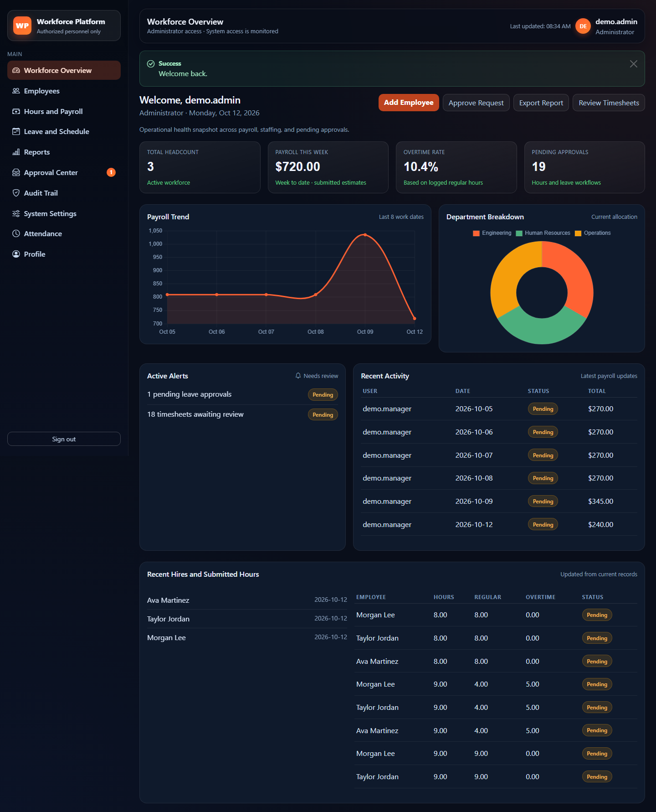
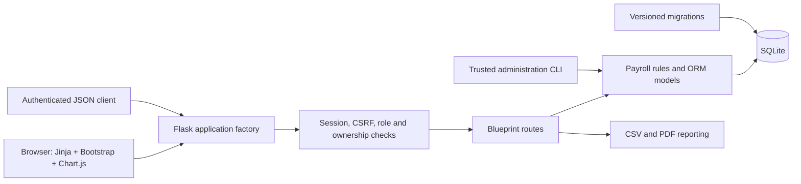
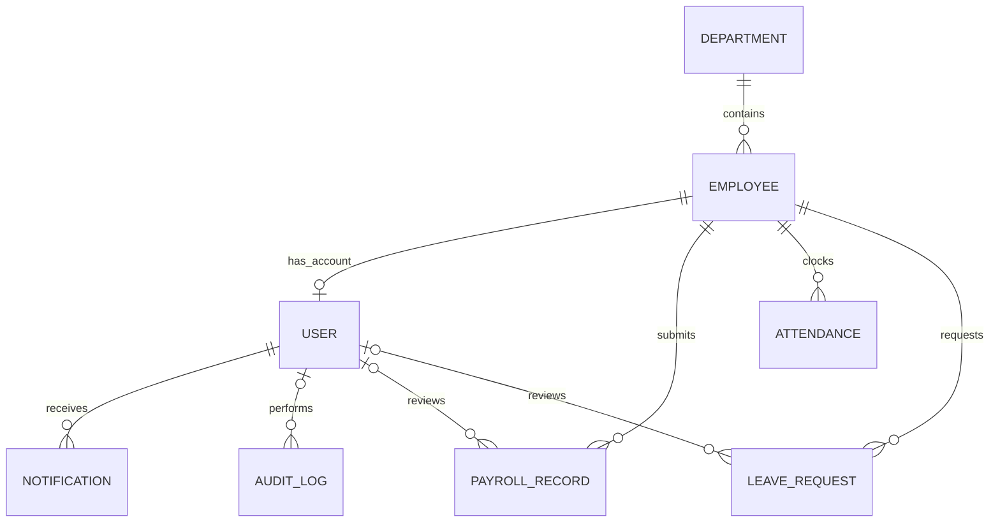

# Workforce Platform

A full-stack employee operations application built with Python and Flask. It brings employee records, time entries, attendance, leave approvals, notifications, and payroll estimates into one role-aware workspace.

Built by **Anotida Hondonga** as a software engineering portfolio project. The existing Flask/Jinja architecture is preserved and strengthened with explicit migrations, tested business rules, and safer administration.

**Status:** verified local demo and portfolio build. Production use requires credential rotation, reconciliation of imported payroll, deployment review, and jurisdiction-specific payroll validation. No public deployment is included.



## The problem

Small teams often track employee details, hours, attendance, and leave in separate spreadsheets. This application connects those workflows, gives employees a personal workspace, and gives authorized staff review tools and an audit trail.

## Features

- Employee directory with search, department/role/status filters, profiles, editing, and archival that preserves records.
- Employee-only registration, hashed passwords, CSRF-protected sessions, login throttling, and explicit CLI administration.
- Daily timesheet totals, Monday–Sunday overtime allocation, decimal monetary calculations, submitted rate snapshots, and approval resets after corrections.
- Clock-in/out with UTC storage, configurable display timezone, and a database constraint preventing duplicate active shifts.
- Leave date validation, overlap prevention at both application and database levels, authorized reviews, and self-approval protection.
- Private notification inboxes, searchable audit logs, charts, and CSV/PDF exports with empty-dataset handling.
- Paginated, authenticated read-only JSON APIs for employees, payroll, and attendance.
- Responsive Bootstrap/Jinja screens with local frontend assets, accessible focus states, clear errors, and mobile directory cards.

## Stack and architecture

Python **3.12** is the verified runtime. Flask, Flask-Login, Flask-WTF, Flask-Limiter, SQLAlchemy, SQLite, Flask-Migrate/Alembic, Jinja2, Bootstrap, Chart.js, ReportLab, Pytest, Ruff, Bandit, and GitHub Actions.



`app/` contains the factory, domain models, payroll rules, shared validation, and blueprints. `app/templates/` and `app/static/` provide the frontend. `migrations/` owns database changes; startup never mutates the schema. `tests/` exercises behavior and security. `scripts/` contains browser verification, safe environment setup, backup, and tracked-file checks.

## Database design

Eight domain tables model departments, employees, users, payroll records, attendance records, leave requests, notifications, and audit logs.



Foreign keys are enforced on SQLite connections. Unique daily payroll entries and active shifts, monetary/date constraints, indexes, leave overlap triggers, and optimistic versions for payroll/leave protect data integrity. Employee archival disables associated login access and retains history. Payroll voiding retains the row and recalculates its workweek.

## Authentication and permissions

Registration always creates an employee role and cannot claim an existing employee email. It is disabled by default in production. Elevated roles are assigned using `flask set-role` by someone with trusted server access.

| Action | Employee | Manager | HR | Payroll | Admin / Executive |
|---|---|---|---|---|---|
| Personal profile, leave, inbox | Own | Own | Own | Own | Own |
| Workforce/report/API read access | Own operations; team directory | Organization | Organization | Organization | Organization |
| Create/edit employee records | — | — | Yes | — | Yes |
| Archive employee records | — | — | — | — | Yes |
| Review payroll / log another employee's hours | — | Yes | — | Yes | Yes |
| Review leave / attendance actions for others | — | Yes | Yes | — | Yes |

Every inbox remains private, including administrator inboxes. Reviewers cannot approve their own payroll or leave. Management read access is organization-wide; department-level manager scoping is a future improvement.

## Install and run a fresh local demo

These steps apply to a **fresh clone**. For an existing installation, follow [migration and backup instructions](docs/MIGRATIONS.md) first.

```powershell
git clone https://github.com/AnoHondz/employee-Data-base.git
cd employee-Data-base
git checkout codex/workforce-production-readiness
py -3.12 -m venv .venv
.\.venv\Scripts\Activate.ps1
python -m pip install -r requirements-dev.txt
python -m scripts.configure_environment
python -m flask --app run db upgrade
python -m flask --app run seed-demo
python run.py
```

Open **http://127.0.0.1:5000**. `seed-demo` creates synthetic employees and generates a fresh password for each of `demo.admin`, `demo.employee`, and `demo.manager`, displayed once in your terminal. There is no shared demo password. Seeding refuses a populated database and is disabled in production.

On macOS/Linux, use `python3.12 -m venv .venv` and `source .venv/bin/activate`; the remaining Python commands are identical. Install `requirements.txt` if you only need the application; `requirements-dev.txt` adds verification tools.

To create your own local administrator instead of demo data:

```text
python -m flask --app run create-admin
```

The CLI prompts for username, email, and a hidden, confirmed password of 12–128 characters. It never runs at startup. Password changes and role assignments are explicit:

```text
python -m flask --app run reset-password USERNAME
python -m flask --app run set-role USERNAME manager
```

## Configuration

`.env.example` contains placeholders only. `scripts.configure_environment` creates `.env` with a fresh random secret and refuses to overwrite an existing file. Environment variables override `.env` values.

| Variable | Purpose |
|---|---|
| `FLASK_SECRET_KEY` | Required random secret, at least 32 characters; use 64 hex characters |
| `APP_ENV` | `development` or `production`; production enables secure cookies and disables public registration |
| `DATABASE_URL` | Absolute SQLite URL; defaults to `instance/workforce.db` |
| `WORKFORCE_TIMEZONE` | IANA timezone used for attendance day/display; defaults to `UTC` |
| `RATELIMIT_STORAGE_URI` | `memory://` locally; production requires shared storage such as Redis |

Production startup rejects missing/short secrets, debug mode, insecure cookies, and in-memory rate-limit storage. Use an HTTPS reverse proxy, a suitable WSGI server, private storage, and verified backups before production deployment. The bundled server binds to localhost and disables debug.

## Payroll and attendance rules

An entry represents the **total of all shifts on one work date**, with 0–24 hours and at most two decimal places. Saving the same employee/date replaces that daily total, rather than creating duplicates. Dates cannot be in the future.

The workweek runs **Monday through Sunday**. The first 40 hours are regular hours; later hours use the employee's submitted overtime multiplier. For five 9-hour days at $30/hour and 1.5× overtime: 40 regular hours + 5 overtime hours = **$1,425.00**. Corrections recalculate the whole affected week and reset changed approvals. A selected reporting pay period never resets a workweek's overtime threshold.

Money uses `Decimal` with half-up cent rounding and submitted compensation snapshots. Reports exclude rejected/voided entries; pending/reviewed entries remain estimates. Payroll and leave updates use optimistic versions to prevent stale reviews from overwriting corrections.

Attendance is stored in UTC and displayed in the configured timezone. Shifts may last at most 24 hours. Attendance does not automatically create payroll entries; daily timesheet totals remain a separate review workflow. Overnight shifts must be allocated to work dates when submitting timesheets. A trusted operator can reconcile incorrect or stale shifts using `correct-attendance` with offset-aware timestamps; see [business rules](docs/BUSINESS_RULES.md).

## Testing and quality

```text
python -m pytest -q
python -m ruff check app tests scripts migrations config.py run.py
python -m ruff format --check app tests scripts migrations config.py run.py
python -m bandit -r app config.py run.py
python -m scripts.security_check
python -m pip_audit -r requirements.txt
python -m playwright install chromium
python -m scripts.browser_smoke
```

Tests use disposable databases and freshly generated credentials. The GitHub Actions workflow runs these checks on pushes and pull requests. Local verification results and scope are recorded in [verification notes](docs/VERIFICATION.md); a successful local run does not imply that GitHub CI or a production deployment has passed.

## Screenshots

Captured from the running application with synthetic records on October 12, 2026:

| Screen | Preview |
|---|---|
| Login | [Screenshot](docs/screenshots/login.png) |
| Employee workspace | [Screenshot](docs/screenshots/employee-workspace.png) |
| Directory and employee profile | [Directory](docs/screenshots/employees.png) · [Profile](docs/screenshots/employee-profile.png) |
| Payroll | [Screenshot](docs/screenshots/payroll.png) |
| Attendance and leave | [Attendance](docs/screenshots/attendance.png) · [Leave](docs/screenshots/leave.png) |
| Notifications, reporting, audit | [Inbox](docs/screenshots/notifications.png) · [Reports](docs/screenshots/reports.png) · [Audit](docs/screenshots/audit.png) |
| Mobile | [Dashboard](docs/screenshots/dashboard-mobile.png) · [Directory](docs/screenshots/employees-mobile.png) · [Payroll](docs/screenshots/payroll-mobile.png) |

Regenerate only from a successful run using `python -m scripts.browser_smoke --screenshots`.

## Security, migrations, and limitations

Earlier Git history contains `.env`, SQLite databases, and hardcoded credentials. Current tracking excludes them, but history is unchanged. **Rotate all exposed secrets and account passwords before using a migrated installation.** See [security and rotation instructions](docs/SECURITY.md), [audit findings](docs/AUDIT.md), and [migration procedures](docs/MIGRATIONS.md).

The migration preserves imported payroll totals and marks them for reconciliation because the old app mixed daily and weekly hours. Imported entries are read-only in the browser. No existing database is reset, and destructive downgrades are refused; rollback uses verified backups and the matching previous code.

Known limitations: payroll estimates exclude taxes, deductions, benefits, holiday rules, and jurisdiction-specific compliance; manager read access is organization-wide; notifications are in-app only; no SSO/MFA/email verification or email password recovery; SQLite and report exports are suitable for modest datasets, without large-scale concurrency/performance claims. Inline template scripts currently require an `unsafe-inline` CSP allowance. Production infrastructure and shared Redis rate limiting have not been exercised here.

## Portfolio description and verified résumé bullets

**Workforce Platform:** a Flask/SQLAlchemy application connecting employee management, timesheet review, attendance, leave approval, reporting, and audit workflows, with a responsive Jinja/Bootstrap interface and automated security/business-rule verification.

- Strengthened a Flask employee operations platform with role and ownership checks, CSRF protection, login throttling, private notifications, and explicit administrator provisioning.
- Implemented workweek-aware decimal payroll calculations, rate snapshots, correction-driven approval resets, and record-preserving SQLite migrations with integrity checks.
- Built automated workflow and security regression tests, a Chromium browser verification script, GitHub Actions quality checks, and recruiter-facing documentation with real application screenshots.

## Future improvements

Department-scoped manager permissions; MFA/SSO and email verification; explicit reconciliation tooling for imported weekly payroll; PostgreSQL migrations and load testing; nonce-based CSP and extracted scripts; payroll policy validation for a chosen jurisdiction; automated attendance-to-timesheet allocation with approved timezone rules.

## Troubleshooting

- **Secret validation error:** regenerate a random secret and set `FLASK_SECRET_KEY` in `.env`; previously exported environment variables take precedence.
- **No such table:** run `python -m flask --app run db upgrade` against the intended `DATABASE_URL`.
- **Environment setup refuses to run:** `.env` already exists; preserve it and update its configuration manually.
- **Demo seed refuses to run:** the database already contains records. Create an administrator explicitly or use a separate new demo database; never reset existing data.
- **CSRF error:** refresh the form and retry; cookies must be enabled. Logout is a POST action through the Sign out button.
- **Imported payroll blocks a correction:** reconcile the historical entry's daily/weekly meaning using original timesheets, as described in the migration guide.
- **PowerShell activation blocked:** invoke `.\.venv\Scripts\python.exe` directly in place of `python`; activation is optional.
- **Browser verification cannot launch Chromium:** run `python -m playwright install chromium`; on Linux CI use `--with-deps`.
